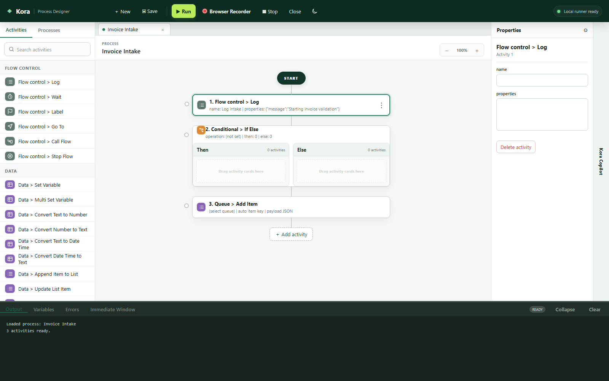
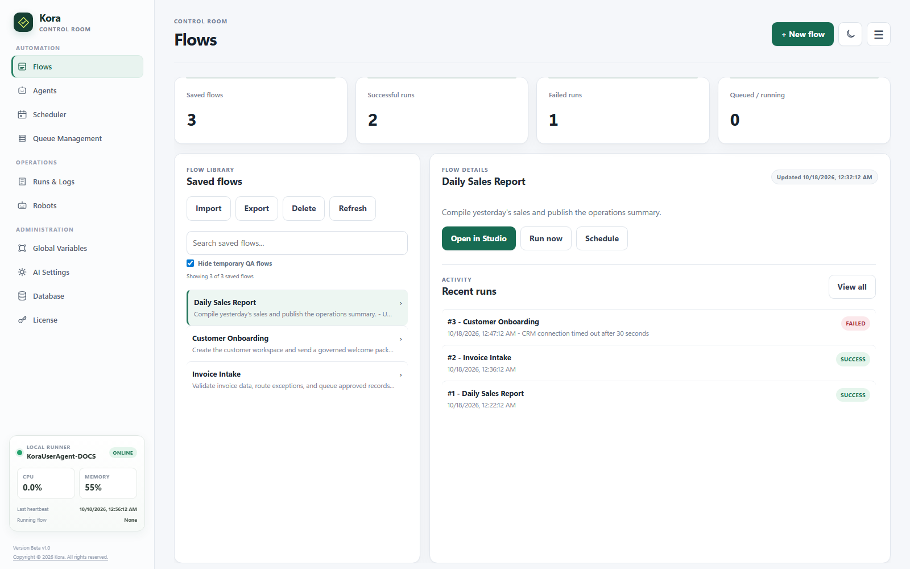
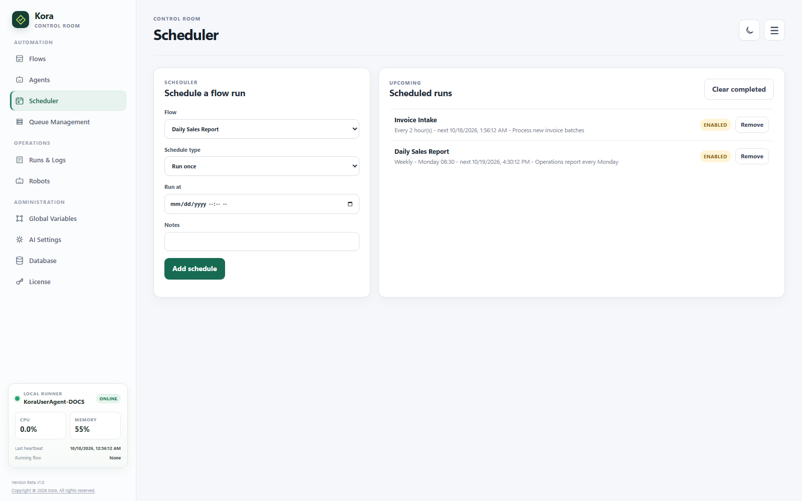
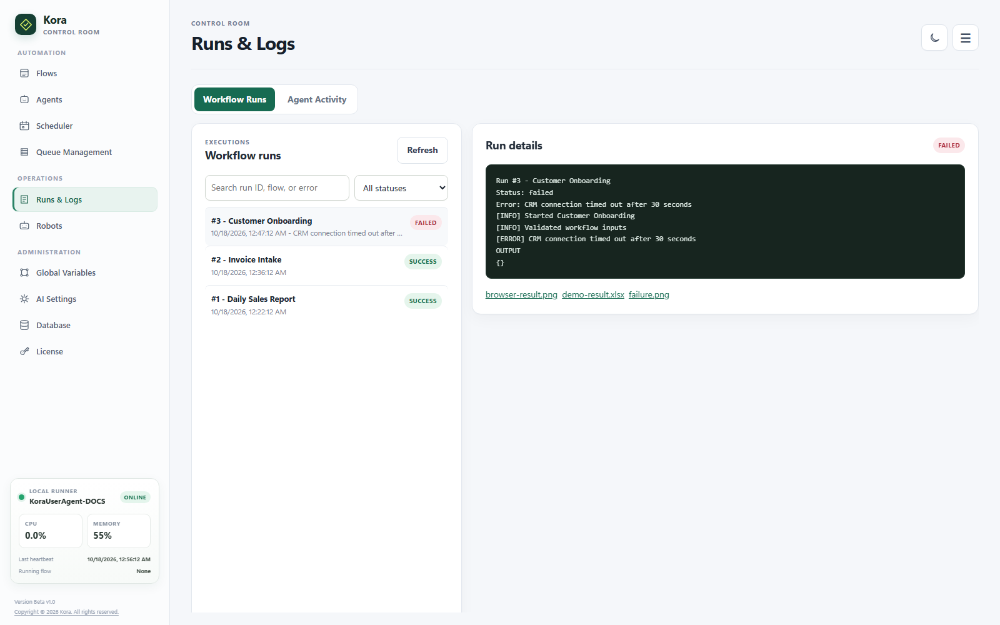
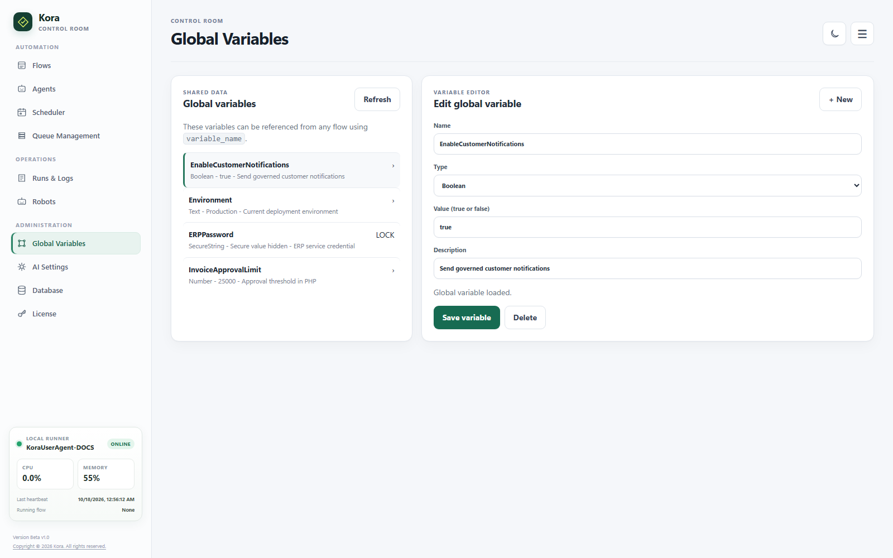
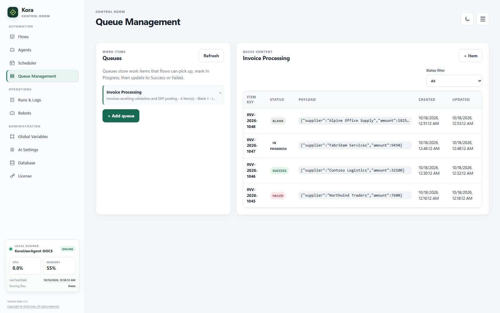
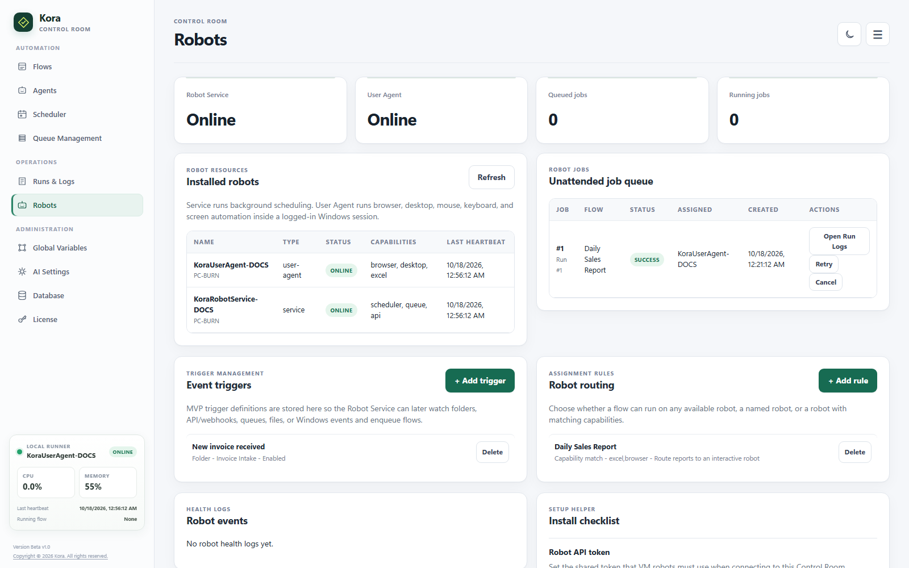
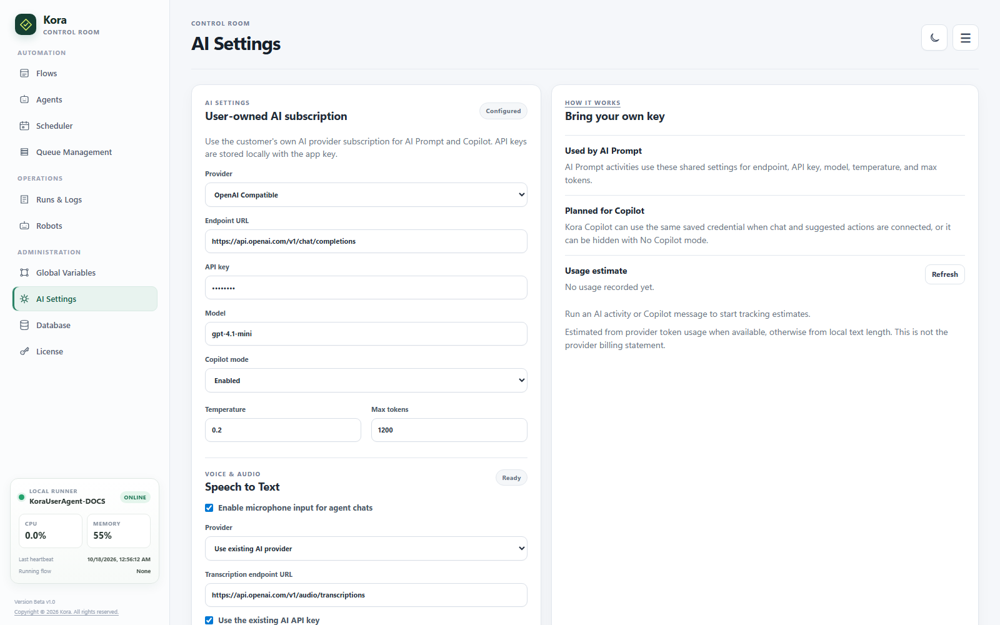
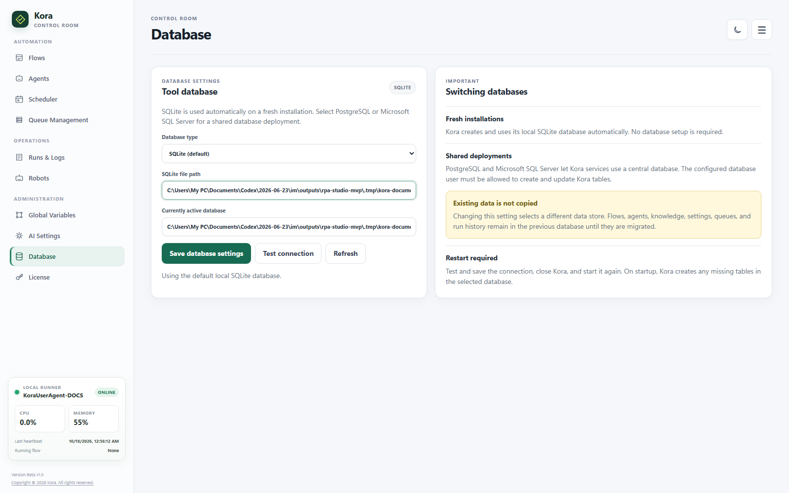
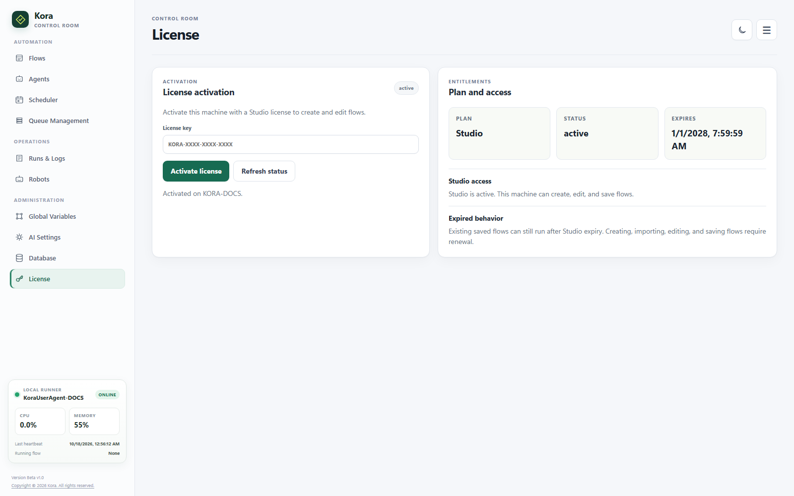

<nav class="doc-home-link"><a href="{{ '/' | relative_url }}">&larr; Go back Home</a></nav>

# Quick Start

## Build And Run A Flow

1. Start Kora with `run_desktop.bat`.
2. Open Process Designer.
3. Add activities from the left activity library.
4. Configure each activity in Properties.
5. Save the flow.
6. Click Run to execute in designer mode.
7. Review the output panel and run logs.

## Control Room

Control Room is the operational area for managing agents, knowledge bases, saved workflows, schedules, queues, robots, runs, logs, and platform settings. Its sidebar groups pages under Automation, Operations, and Administration.

## Flows

Use Flows to create, edit, save, and run processes.

## Agents

Use Agents to chat with saved AI agents or open the separate Agent Workspace for configuration and testing.

1. Select **+** to create an agent, choose its avatar, and configure its system prompt.
2. Select **Visualize prompt** to review a local workflow interpretation of the current prompt and selected capabilities.
3. Save the agent, then single-click it in the library to chat. Double-click it to reopen Agent Builder.
4. Use **Chat history** to reopen saved conversations, or use the pop-out icon for a dedicated chat window.
5. Review the audit trail under **Runs & Logs > Agent Activity**.

The subtitle below each library agent shows its latest chat session. Side-effecting flows ask for confirmation only when the agent attempts the action.

See:

[Agentic AI and Kora Agents](21%20-%20Agents.html)

## Scheduler

Use Scheduler to run saved workflows at a configured time or recurrence.

Scheduler-created runs are unattended jobs.

## Runs & Logs

Use **Workflow Runs** to review:

- Run status
- Step logs
- Errors
- Output variables
- Robot execution details

Use **Agent Activity** to search and filter agent sessions, messages, flow-tool calls, approval requirements, specialist delegations, guardrail events, and linked workflow runs.

## Global Variable

Use Global Variables to store shared values that workflows can read at runtime.

Typical examples:

- Environment names
- API base URLs
- Shared folder paths
- Non-secret configuration values

## Queue Management

Use Queue Management to create queues, add queue items, process pending work, and update item status.

See:

[Queue Management.md](Activities/Files%20Queues%20API%20and%20Scripting/Queue%20Management.html)

## Robots

Use Robots to monitor robot resources, heartbeats, user agents, robot jobs, and event triggers.

See:

- [Robot Service and User Agent.md](Robot%20Service%20and%20User%20Agent.html)
- [Distributed Control Room and VM Robot Setup.md](Distributed%20Control%20Room%20and%20VM%20Robot%20Setup.html)
- [Event Triggers.md](Activities/Event%20Triggers/Event%20Triggers.html)

## AI Settings

Use AI Settings to configure the provider, endpoint URL, API key, model, temperature, and max tokens used by AI activities.

See:

[AI Prompt.md](Activities/AI%20Capabilities/AI%20Prompt.html)

## Database

Use Database to keep the default SQLite store or configure PostgreSQL/Supabase or Microsoft SQL Server. Test the connection, save the selection, and restart Kora to activate it. Switching databases does not migrate existing data.

See:

[Database Settings](Database%20Settings.html)

## Themes and Local Runner

Use the theme button to switch Control Room and Process Designer between light and dark themes. Control Room also shows Local Runner CPU, memory, heartbeat, and current-flow status. In Process Designer, drag the panel separators to resize Activities, Properties, and Output.

## License

Use License to activate, refresh, and review the installation's license status.

[18 - Licensing.md](18%20-%20Licensing.html)

