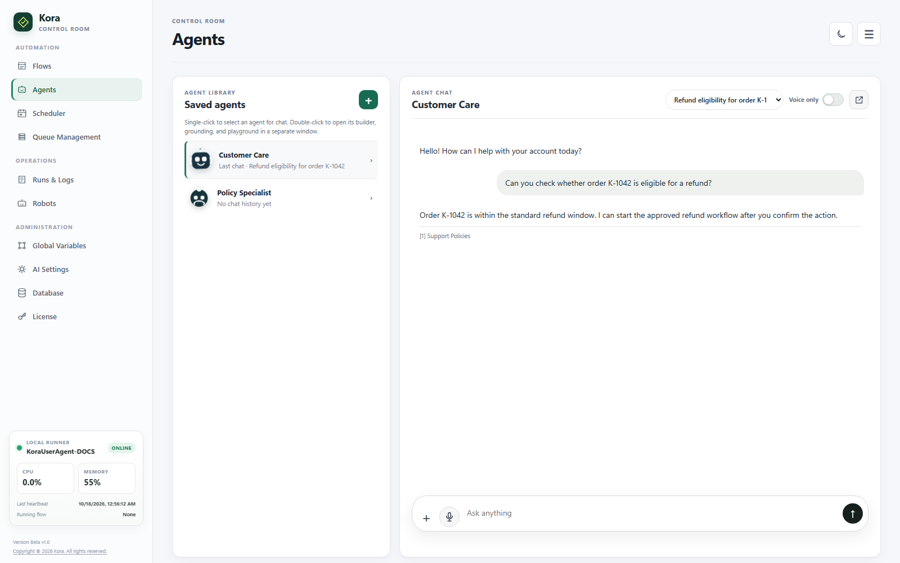
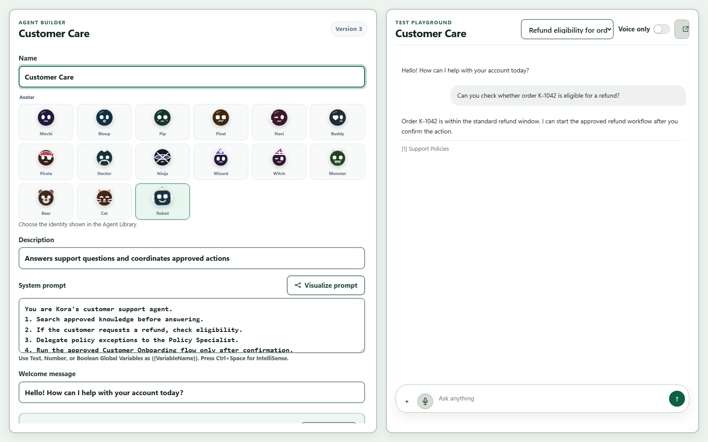
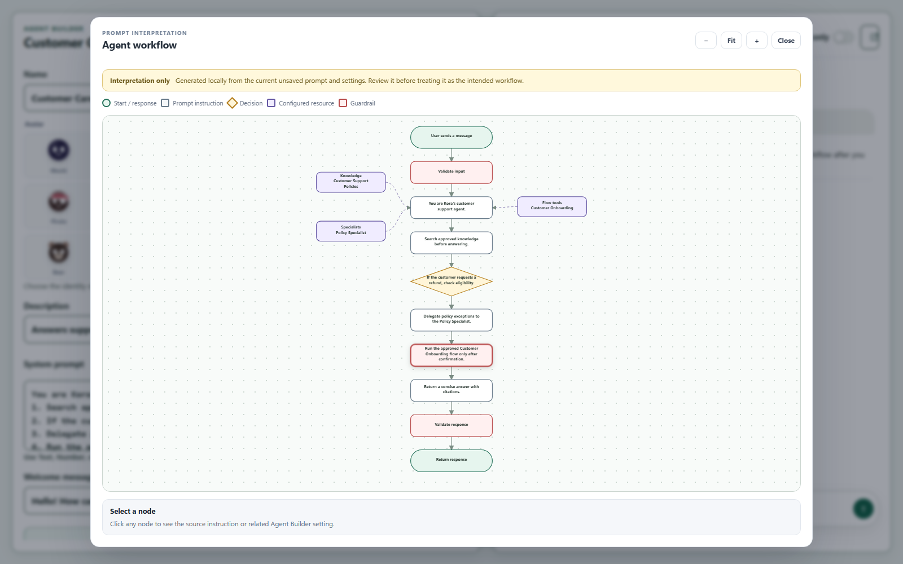
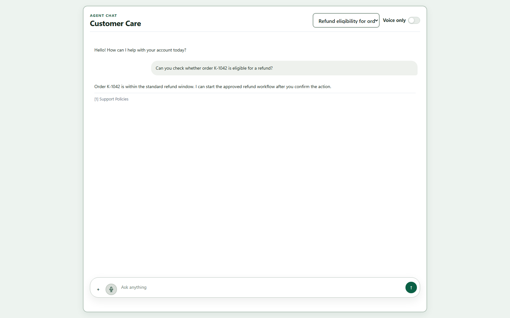
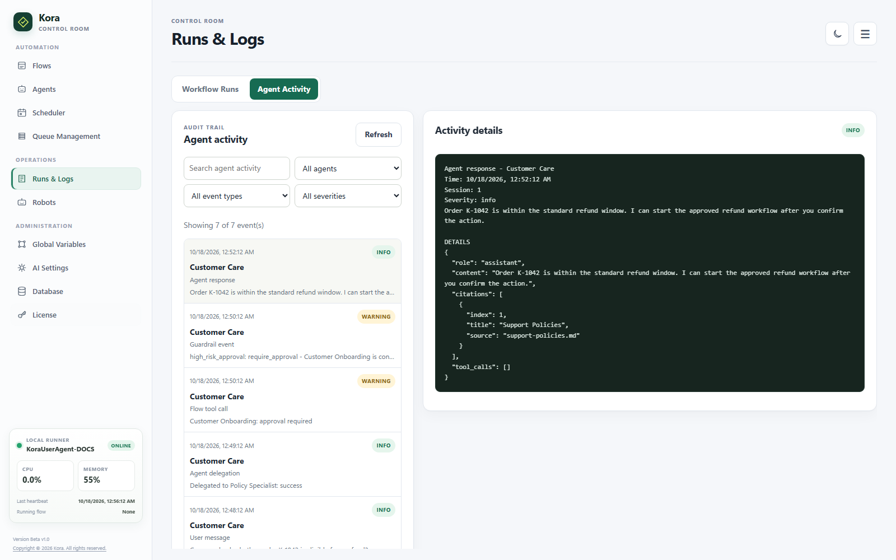

<nav class="doc-home-link"><a href="{{ '/' | relative_url }}">&larr; Go back Home</a></nav>

# Agentic AI and Kora Agents

Kora Agents combine an AI model, reusable knowledge, session memory, explicitly approved Kora flows, and controlled specialist-agent delegation. Agents decide when an action is needed; flows remain the deterministic execution boundary.

## Prerequisites

Configure an OpenAI-compatible endpoint, API key, and default model under **Control Room > AI Settings**. An agent may optionally override the default model.

## Create a Knowledge Base

1. Open **Control Room > Agents**.
2. Double-click an agent, or select **+**, to open the Agent Workspace.
3. Under **Grounding**, select **+ Knowledge**.
4. Enter a name and optional description.
5. Select **Browse files** to choose one or multiple files. Selected files are added to Sources automatically. You can also enter a local folder or `https://` URL per line.
6. Select **Save and ingest**.

Supported sources are TXT, Markdown, CSV, JSON, HTML, PDF, and DOCX. Folders are scanned recursively. Kora stores extracted text in the selected Kora database and retrieves the most relevant passages for each message.

## Create an Agent

1. Select **+** to open the Agent Workspace.
2. Choose an avatar and define the name, description, system prompt, and welcome message.
3. Select **Visualize prompt** to review how Kora interprets the current instructions.
4. Choose Strict, Assisted, or no grounding.
5. Select knowledge bases and the flows the agent is allowed to call.
6. Optionally select specialist agents under **Allowed agent tools**.
7. Set each flow's risk to Low, Medium, High, or Critical. Keep **Require approval** enabled for flows that change files, applications, messages, or external systems.
8. Configure the agent's **Guardrails**.
9. Save the agent. Every save creates a new agent version.

Agent settings also include a model override, temperature, conversation memory, retrieved-passage count, maximum flow calls, maximum agent calls, delegation depth, and citation requirements.

### Global Variables in the system prompt

The system prompt can reference Text, Number, and Boolean values created under **Control Room > Global Variables**. Type `{{VariableName}}`, or press **Ctrl+Space** in the System prompt field to open IntelliSense. Kora retains the reference in the saved agent version and resolves its current value immediately before each AI request. `SecureString` variables are deliberately excluded and are never expanded into system prompts.

### Visualize the prompt workflow

Select **Visualize prompt** beside the System prompt field to turn the current unsaved prompt into a workflow diagram. Kora interprets instructions, decisions, safety language, and response steps, then adds the selected knowledge bases, allowed flows, specialist agents, and guardrails. This runs locally and does not require an AI provider.

Pan and zoom the diagram, then select a node to inspect its source instruction or related setting. The visualization is a review aid: it does not modify the prompt or create an executable Kora Flow.

## Flow Tools and Variables

The Agent Builder reads the selected flow's declared input and output variables. Flow inputs become tool parameters supplied by the model. After the run completes, declared flow outputs are returned to the agent so it can explain the result.

Give flows clear names, descriptions, typed inputs, and declared outputs. An agent cannot call flows that were not selected in its configuration.

## Agent Tools and Delegation

Use **Allowed agent tools** to build a supervisor-and-specialist structure. Only explicitly selected agents are exposed as tools to the supervisor. The supervisor sends a focused task; the specialist runs in a separate conversation session using its own system prompt, knowledge bases, flow permissions, guardrails, and model settings.

The specialist receives the delegated task, not the supervisor's complete conversation history. Its response, citations, flow traces, and nested delegation traces are returned to the supervisor as structured tool data.

Configure these limits per agent:

- **Maximum agent calls:** one to three specialist calls for one message.
- **Delegation depth:** one or two levels below the current supervisor.

Kora blocks self-calls and circular chains. A child agent cannot gain flow or agent permissions from its parent. If a specialist calls a side-effecting flow, the normal per-message approval rule still applies.

Every attempt is written to `agent_delegations` with the parent and child agents, their sessions, the focused task, depth, status, result, citations, nested tool traces, and timestamps.

## Guardrails

Guardrails are deterministic checks around AI calls. They apply to direct chat, locally embedded chat, flow tools, and tasks sent to specialist agents. They run before input is sent to the AI provider, before a selected flow executes, and before the final response is stored and shown.

Configure these rules per agent:

- Enable or disable the guardrail policy.
- Limit input and output length and messages per minute.
- Block selected terms or phrases.
- Allow, record, or block common prompt-injection attempts.
- Allow, redact, or block likely credentials and secrets.
- Restrict web destinations, Windows file locations, and email recipient domains used in flow arguments.
- Always require user approval for flows marked High risk.
- Block flows marked Critical risk, even when message approval is enabled.

Values declared as `SecureString`, and flow fields with credential-like names, are redacted from agent tool traces and AI-visible flow results.

Allowed domain, file-location, and email-domain lists are enforced only when they contain values. Domain entries include their subdomains. Windows file paths use directory boundaries, so allowing `C:\Approved` does not allow a similarly named sibling folder.

Triggered rules are written to `agent_guardrail_events` with the agent, session, phase, rule, action, reason, sanitized preview, and timestamp. Detected credentials are redacted before the event is stored. The latest 100 events are available through `GET /api/agents/{agent_id}/guardrail-events` for audit integrations.

These checks reduce risk but do not replace least-privilege Windows accounts, restricted database credentials, network controls, and careful flow design.

## Grounding Modes

- **Strict:** factual answers must come from retrieved knowledge or successful flow and specialist-agent results. The agent says when the answer is unavailable.
- **Assisted:** retrieved knowledge is preferred, but the model may use general knowledge and should distinguish it.
- **None:** no knowledge restriction is applied.

When citations are enabled, retrieved passages are numbered and returned with their filename or URL.

## Agent Library and Agent Chat

The Agents page is focused on the Agent Library and Agent Chat. Select **+** to create an agent. Single-click an agent to chat; double-click it to open the two-column Agent Workspace, with Agent Builder and Grounding on the left and the Test Playground on the right. The library does not include a separate View Logs button because the audit trail is under **Runs & Logs > Agent Activity**.

Each agent can use a frameless animated avatar selected in Agent Builder. Choices include Mochi, Bloop, Pip, Pixel, Navi, Buddy, Pirate, Doctor, Ninja, Wizard, Witch, Monster, Bear, Cat, and Robot. Faces blink while idle and smile when selected or hovered. Animation respects the operating system's reduced-motion preference.

The subtitle under each agent is the latest saved chat-session title. Kora saves conversations in the selected database and automatically resumes the most recently updated session. Use **Chat history** to reopen an earlier conversation or select **+ New chat** for a fresh context.

The minimalist composer uses **+** for attachments and an arrow to send. It does not display a permanent approval checkbox. When an agent actually attempts a side-effecting or high-risk flow, Kora asks for confirmation at that moment, and the request is retried after confirmation. Critical flows remain blocked when the Critical-flow guardrail is enabled.

Use the pop-out icon at the upper-right of Agent Chat to continue the selected conversation in a dedicated chat-only window. Closing the chat or workspace window leaves Control Room open.

## Voice Behavior

Normal text chat stays text-first: Kora does not automatically play speech or show a Listen control while the user is simply chatting. When Speech to Text is configured, hold the microphone while speaking and release it to transcribe and send.

For a continuous spoken conversation, configure both Speech to Text and Text to Speech under **Control Room > AI Settings**, enable speech for the agent, and use **Voice only**. Leaving Voice only stops the microphone and returns to text chat.

## Runs & Logs

Use **Control Room > Runs & Logs** for both automation and agent audit history:

- **Workflow Runs** searches and filters workflow executions by run ID, flow, error, and status.
- **Agent Activity** records sessions, messages, flow-tool calls, approval requirements, specialist delegations, and guardrail events.
- Filter Agent Activity by agent, event type, severity, or search text, then select an event to inspect its details and linked workflow run.

An agent can make no more than five flow calls and three specialist-agent calls for one message. Flow executions remain under Workflow Runs, while Agent Activity retains the conversational and decision audit trail.

## Publish and Embed Locally

1. Save the agent.
2. Open **Publish & Embed locally** in Agent Builder.
3. Choose a public slug and optionally list the website origins allowed to embed it.
4. Select **Publish embed**.
5. Use **Open** to test the standalone chat or **Copy code** to copy the generated script tag.

The embedded page, widget script, conversations, knowledge, and flow runs are served by the current Kora installation. Records use SQLite by default or the PostgreSQL or Microsoft SQL Server database selected under **Control Room > Database**.

An embed URL containing `127.0.0.1` or `localhost` works only on the same computer. For an intranet website, use a Kora machine reachable from that network and its hostname or LAN IP. LAN or internet exposure must be enabled deliberately and protected with HTTPS, authentication, rate limits, Windows Firewall rules, and restricted allowed origins.

## Chat Attachments

Select **+** beside the message box to attach up to five files, with a maximum of 50 MB each. Attachments remain associated with the current conversation and are supplied only to an allowed flow that declares `FilePath` or `FilePaths` inputs. They are not added to a Knowledge Base and do not become grounding sources.

## Related Documentation

- [Agent Infrastructure](22%20-%20Agent%20Infrastructure.html)
- [Database Settings](Database%20Settings.html)
- [AI Integration](10%20-%20AI%20Integration.html)
- [AI Screen Control](Activities/AI%20Screen%20Control/README.html)
- [Orchestrator](17%20-%20Orchestrator.html)
